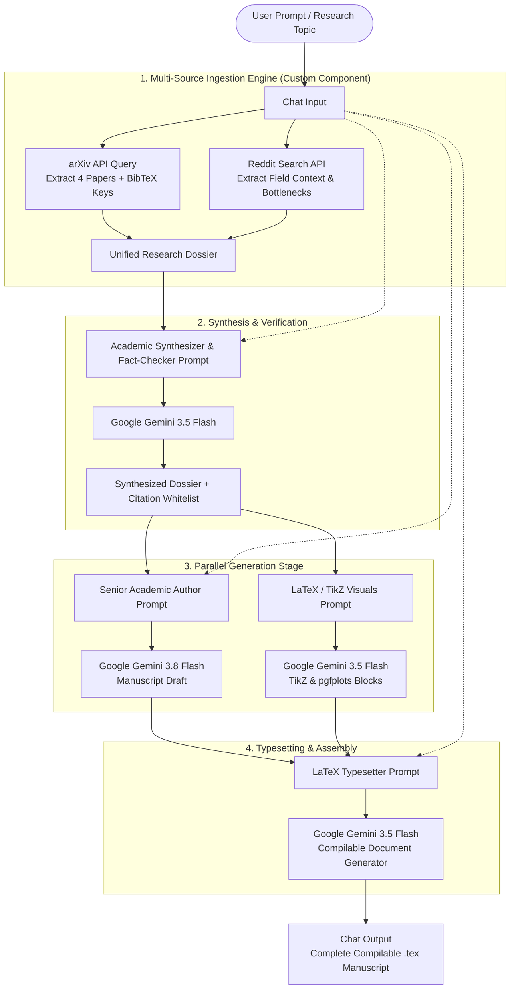

# 📚 Autonomous Research Paper AI Agent

[](https://github.com/langflow-ai/langflow)
[](https://ai.google.dev/)
[](https://www.overleaf.com/)
[](https://opensource.org/licenses/MIT)

An end-to-end autonomous multi-agent research pipeline built with **Langflow**. 

This system accepts a research topic or technical prompt, pulls peer-reviewed literature from **arXiv** and real-world engineering discussions from **Reddit**, synthesizes theoretical foundations with empirical constraints, drafts an academic manuscript, generates production-ready **TikZ/pgfplots** architectural diagrams, and typesets a fully compilable **IEEEtran** LaTeX document (`.tex`).

---

## 🌟 Key Features

- **Automated Dual-Source Ingestion Engine**:
  - Live querying of the **arXiv API** (`http://export.arxiv.org/api/query`) extracting top relevant preprints, metadata, abstracts, and auto-generated BibTeX citation keys.
  - Live retrieval of real-world practitioner challenges and operational bottlenecks from **Reddit** (`https://www.reddit.com/search.json`).
- **Fact-Checking & Citation Whitelisting**:
  - Synthesizes theoretical foundations alongside empirical constraints.
  - Automatically isolates a strict **Citation Whitelist** to eliminate citation hallucination across subsequent generation steps.
- **Parallel Multi-Agent Generation**:
  - **Academic Author Agent** (powered by Gemini 3.8 Flash): Formulates rigorous academic prose, formal equations (`amsmath`), and IEEE/ACM structure (`\section{Introduction}`, `\section{Methodology}`, etc.).
  - **Visuals & Diagram Specialist** (powered by Gemini 3.5 Flash): Produces raw, self-contained LaTeX **TikZ** system architecture diagrams and **pgfplots** comparative evaluation plots.
- **Automated LaTeX Typesetter**:
  - Integrates the drafted text, figures, packages, and `thebibliography` into a standalone, compilable `.tex` file adhering to IEEE conference/article standards.

---

## 🏗️ System Architecture



---

## 🧩 Pipeline Components

| Node / Component | Type | Model / Engine | Purpose |
| :--- | :--- | :--- | :--- |
| **Chat Input** | Core I/O | User UI | Captures user topic or query (e.g., *"Hybrid Mamba-Transformer architectures"*). |
| **1. Multi-Source Ingestion Engine** | Custom Component | Python `urllib` & `xml.etree` | Queries arXiv for academic papers (generates BibTeX keys) and Reddit for field issues. |
| **Academic Synthesizer** | Prompt Template | `gemini-3.5-flash` | Synthesizes theory, trade-offs, bottlenecks, and defines a strict citation whitelist. |
| **Author Agent** | Prompt Template | `gemini-3.8-flash` | Drafts a formal IEEE/ACM paper with mathematical equations and strictly whitelisted citations. |
| **Visuals Agent** | Prompt Template | `gemini-3.5-flash` | Generates system architecture diagrams (TikZ) and comparative charts (pgfplots). |
| **Typesetter Agent** | Prompt Template | `gemini-3.5-flash` | Assembles text and figures into a complete, compilable `\documentclass[conference]{IEEEtran}` `.tex` file. |
| **Chat Output** | Core I/O | Output UI | Emits the complete LaTeX manuscript. |

---

## 📂 Repository Structure

```text
.
├── flows/
│   └── research-agent.json    # Complete Langflow flow configuration
├── .gitignore                 # Standard Python, Langflow, and LaTeX ignores
└── README.md                  # Project documentation and setup guide
```

---

## 🚀 Getting Started

### 1. Prerequisites

- **Python 3.10+**
- **Langflow** (`>= 1.0.0`)
- **Google Gemini API Key** with access to `gemini-3.5-flash` and `gemini-3.8-flash`.
- (Optional) **LaTeX Distribution** (TeX Live, MacTeX, or MikTeX) or an [Overleaf](https://www.overleaf.com/) account for compiling generated `.tex` files.

### 2. Installation

1. **Clone the repository:**
   ```bash
   git clone https://github.com/Musharraffaijaz/langflow-agent.git
   cd langflow-agent
   ```

2. **Set up a virtual environment and install Langflow:**
   ```bash
   python -m venv .venv
   source .venv/bin/activate  # On Windows: .venv\Scripts\activate
   pip install langflow
   ```

3. **Export your Google Gemini API Key:**
   ```bash
   export GEMINI_API_KEY="your-gemini-api-key-here"
   ```

### 3. Launching and Importing the Flow

1. **Start the Langflow server:**
   ```bash
   langflow run
   ```
2. Open your browser and navigate to `http://localhost:7860`.
3. In Langflow, click **"New Flow"** (or **"Import"**).
4. Select or drag-and-drop [`flows/research-agent.json`](file:///home/surface_linux/projects/ai-agents/langflow-agent/flows/research-agent.json).
5. Ensure your `GEMINI_API_KEY` global variable or component fields are set.

---

## 🖥️ Usage

1. Open the **Playground** inside the Langflow UI.
2. Enter any research topic or domain, for example:
   - *"State Space Models vs. Attention Mechanisms in Long-Context LLMs"*
   - *"Diffusion Models for Zero-Shot Trajectory Planning in Robotics"*
   - *"Sparse Autoencoders for Interpretable Feature Steering in Foundation Models"*
3. The pipeline will:
   - Search arXiv and Reddit.
   - Synthesize the dossier.
   - Concurrently write the paper and generate TikZ/pgfplots visuals.
   - Format and output the full LaTeX document.
4. Copy the resulting LaTeX code into Overleaf or save it as `paper.tex` and compile:
   ```bash
   pdflatex paper.tex
   bibtex paper
   pdflatex paper.tex
   pdflatex paper.tex
   ```

---

## ⚙️ Customization

- **Add More Sources**: Extend `MultiSourceIngestionEngine` to query Semantic Scholar, PubMed, or Hugging Face Papers.
- **Change Journal Templates**: Modify the Typesetter Prompt to output `neurips_2026.sty`, `acmart`, or `nature` templates.
- **Switch Models**: Swap Gemini components for other providers (e.g., Anthropic Claude, OpenAI GPT-4o, or local Ollama instances) supported natively by Langflow.

---

## 📄 License

This project is licensed under the [MIT License](LICENSE).
